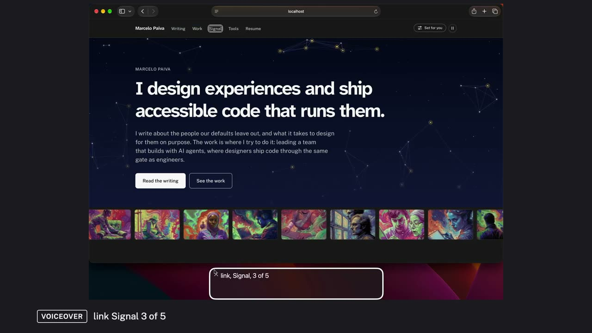
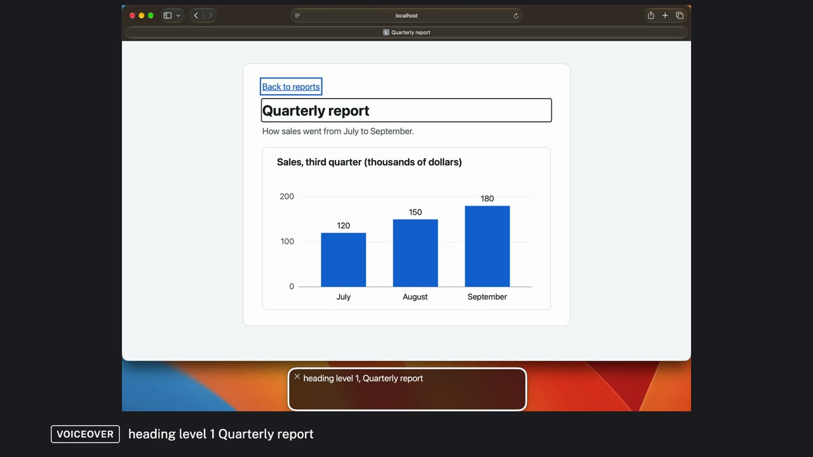

# Examples

Each example is a first-pass accessibility test made with the a11y-demo skill: real VoiceOver in Safari,
filmed and narrated, with every barrier named by its WCAG criterion, fixed, and heard again. Open a folder:
its README is the report, with the videos. The same reports, with the videos playing in the page, are on
the project's GitHub Pages site.

## [Testing the home page with VoiceOver](menu-stall/)

A first-pass screen-reader test of a real personal site's home page, in short videos with one narrator: the structure, the keyboard, a reading pass, the controls and a task, with what it found, what was fixed, and what still needs testing with people with disabilities.

10 videos, about 19 minutes, captioned, with transcripts. 6 findings: 3 fixed, 1 fix in review, 1 open, 1 not the page.

Criteria: WCAG 4.1.2 Name, Role, Value · WCAG 4.1.3 Status Messages

## [Testing the home page with VoiceOver, told by two voices](menu-stall/duo/)

The same home-page test told by two voices: a tester who uses VoiceOver and says what she hears, and a reviewer who names each WCAG criterion, says why it matters and explains the fix.

9 videos, about 21 minutes, captioned, with transcripts. 6 findings: 3 fixed, 1 fix in review, 1 open, 1 not the page.

Criteria: WCAG 4.1.2 Name, Role, Value · WCAG 4.1.3 Status Messages

## [Three WCAG criteria, heard with VoiceOver](wcag/)

Three barriers on small example pages, each heard with VoiceOver in Safari, fixed, and heard again: a chart with no text alternative, links that all say Read more, and switches a screen reader can't find.

3 videos, about 6 minutes, captioned, with transcripts. 3 findings: 3 fixed.

Criteria: WCAG 1.1.1 Non-text Content · WCAG 2.4.4 Link Purpose (In Context) · WCAG 4.1.2 Name, Role, Value

---

Built by `tools/a11y-demo/examples-index.mjs` from each example's `report.json`.
