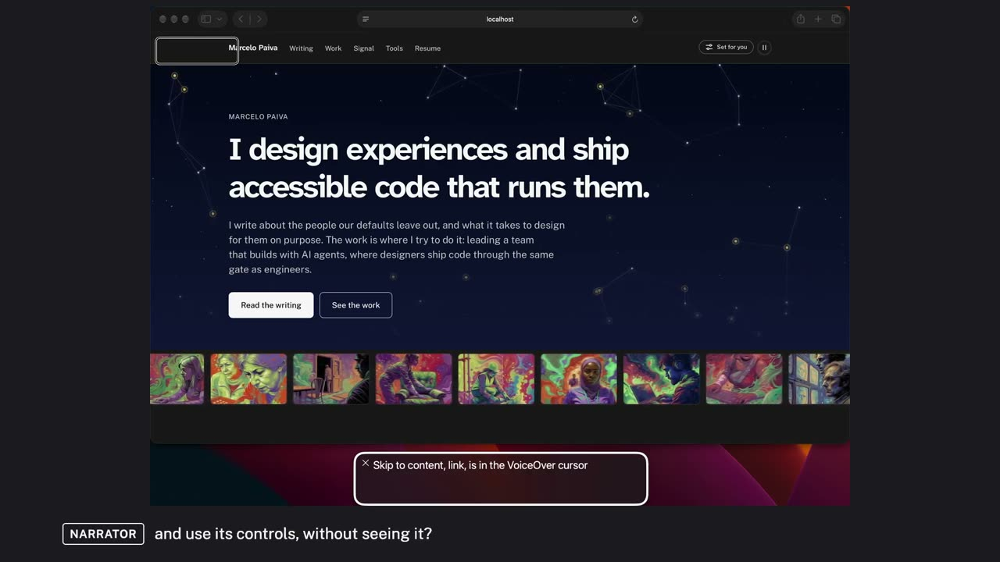
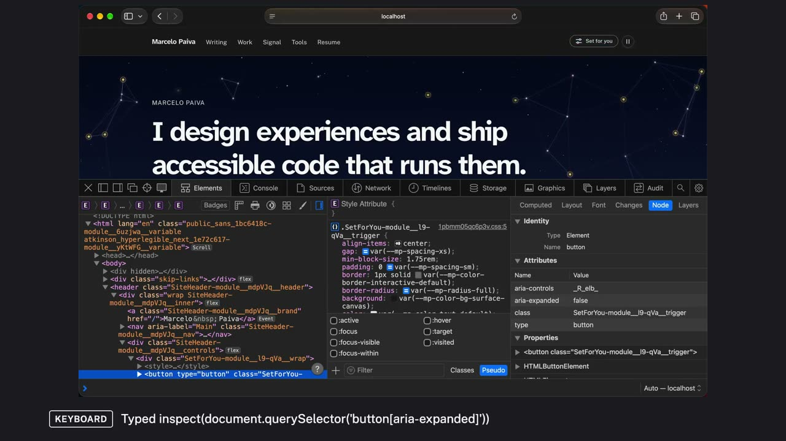
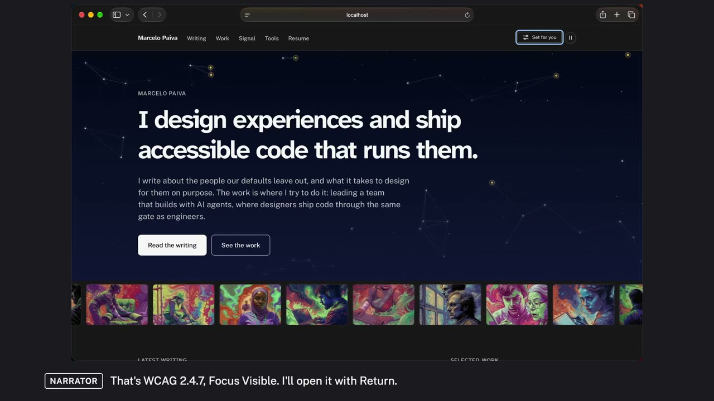
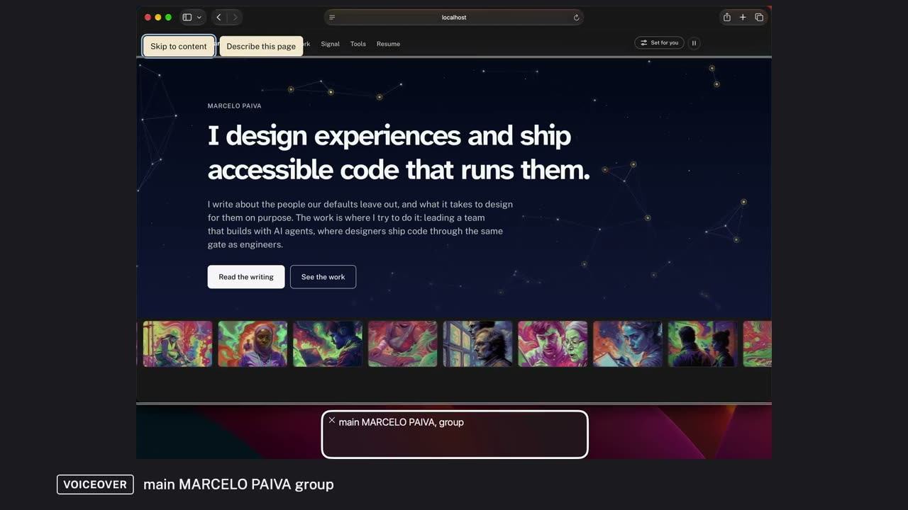
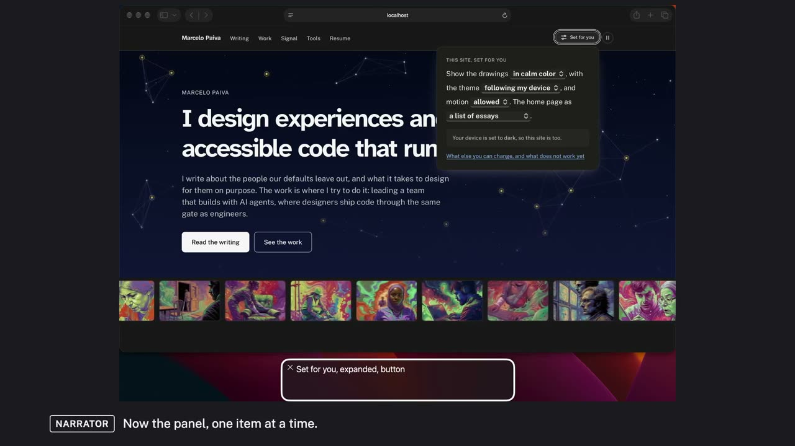
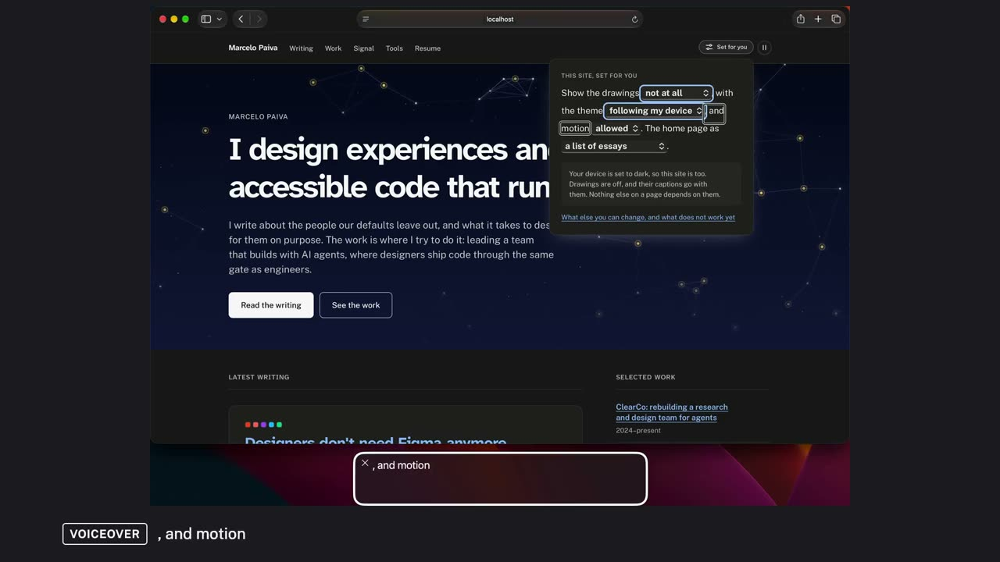
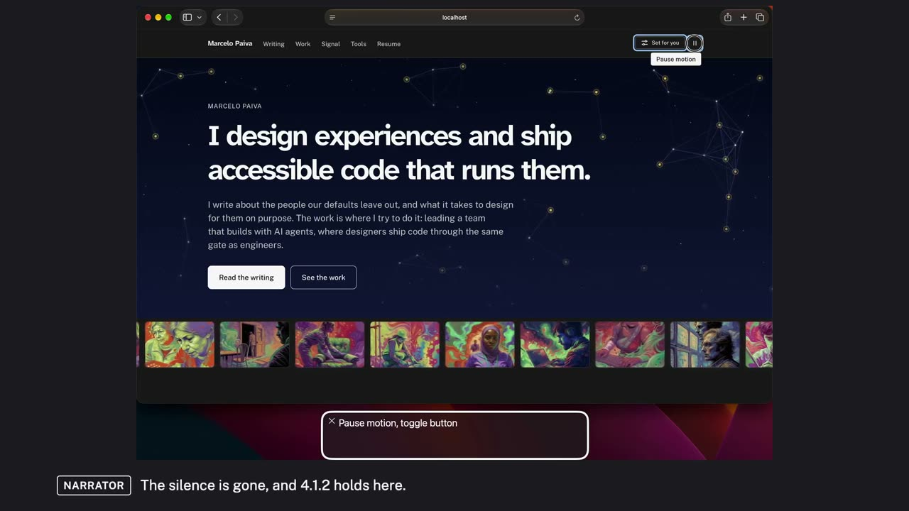
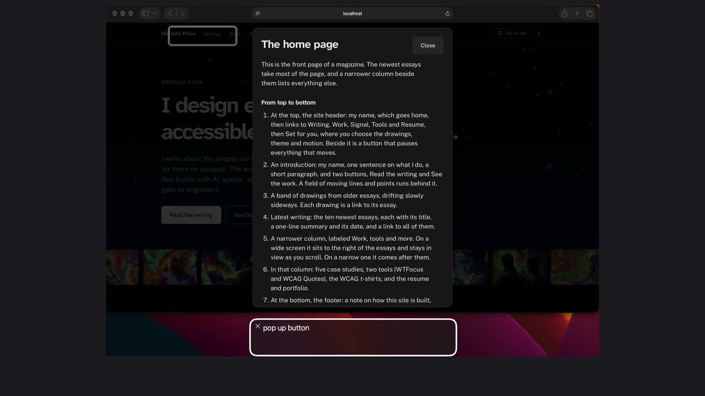
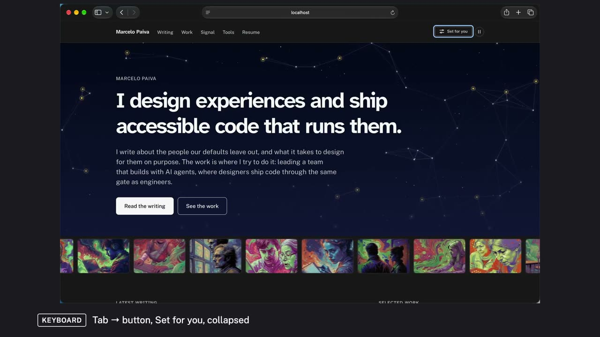

# Testing the home page with VoiceOver

A first pass at testing this site's home page with VoiceOver, the screen reader built into the Mac, before testing it with people with disabilities. The goal was to find barriers early and fix them. Each step is a short video; each problem found was fixed and tested again.

Each still opens its video. To watch them in the page, with captions you can turn on and off, download this folder and open [index.html](index.html) in a browser.

## The brief

The home page works with a keyboard and a screen reader for most of what was tested. It has a skip link, a clear outline of headings, named regions, and controls that say what they are and what state they are in. Focus is always visible, and Escape always puts it back where you were.

The test found five problems on the page. Three are fixed and live, one fix is in review, and one, a small one, is still open. One more thing heard was VoiceOver and Safari, not the page.

- **Fixed: A hidden menu held VoiceOver for four presses.** Just after the Set for you button, VoiceOver said “menu” four times and didn’t move. There was no menu on screen: the closed settings panel still held its four dropdowns, and Safari passed them to VoiceOver. Someone listening would think the page had stopped. Fixed: the panel is now left empty while it is closed. Live since October 16, 2026. WCAG 4.1.2 Name, Role, Value · [Watch it](#reading-pass)
- **Fixed: Changing a setting wasn’t announced.** Turning the drawings off worked, but nothing said so. The note confirming it was only on screen, so someone listening had to go and look for it. Fixed: a status line now says what each change did. VoiceOver says “Drawings are off and their captions go with them.” Live since October 17, 2026. WCAG 4.1.3 Status Messages · [Watch it](#task)
- **Fix in review: Describe this page opened in silence.** The button that describes the page’s layout in words opened its dialog without VoiceOver saying anything. Someone listening wouldn’t know it had opened, though what it says is useful once you find it. A fix makes the dialog read its title and first sentences when it opens. It was heard working, and is in review, not yet live. Not a WCAG failure on its own; it stops the feature doing its job · [Watch it](#describe)
- **Fixed: Essay links in the drawing strip read their title twice.** In the band of drawings, each link read its essay’s title twice, then the whole summary. The links made sense, but a list of them was slow to get through. Fixed: each link now says its title once, then the summary. Live since October 16, 2026. WCAG 2.4.4 Link Purpose is met; a listening cost · [Watch it](#structure)
- **Open: The strip’s preview is read again after its links.** Reading the page item by item, the preview card for the drawing in the middle of the strip is read after the strip’s links, so one essay’s title and summary are heard a third time. Open: hiding the preview from screen readers would stop it, while its summary still reaches the link. Not done yet. No WCAG failure; a listening cost
- **Not the page: Choosing from a dropdown reads the old value first.** When you pick a new value in a dropdown, VoiceOver first reads the value it had before. This happens with Safari’s standard dropdown, not because of the page; the status line now follows it with the right answer. VoiceOver in Safari · [Watch it](#task)

> **An earlier draft.** This is the first, one-narrator version of the test, kept as it was made. The <a href="duo/">two-voice version</a> is the current one: it adds the fixes made since, and corrects this draft’s Describe this page finding. The dialog did not open in silence; that came from the test runner, not the page.
>
> **What these videos are.** VoiceOver in Safari, on macOS 27, driven by a script so each test can be run again the same way. What you hear from VoiceOver is what it said. The narrator is a synthetic voice, describing what a tester listens for.
>
> **What they are not.** An audit, or a claim that the site conforms to WCAG. It is one specialist, one screen reader and one browser, on one page. Nobody who uses a screen reader every day took part: that comes next, in the recommendations.
>
> **Captions.** Every video has captions for both voices on screen. They are also in each video as a captions track, and as a file you can download, with a transcript under each video.

## How it was tested

1. **Inspect the page structure before using the screen reader.** Goal: understand the intended structure and find obvious semantic problems. [Video](#structure-code)
2. **Test keyboard-only navigation.** Goal: the page works without a mouse, before the screen reader comes in. [Video](#keyboard)
3. **A linear reading pass with the screen reader.** Goal: the experience of discovering and understanding the page. [Video](#reading-pass)
4. **Structural navigation: headings, landmarks, links.** Goal: finding information without reading the whole page. [Video](#structure)
5. **Controls and interactive components.** Goal: controls are understandable and usable, not merely discoverable. [Video](#control)
6. **Real user tasks, start to finish.** Goal: people can complete what they came to do. [Video](#task)

## The videos

### Overview

[Watch the video](v0-draft-1.mp4) (0:57, captions on screen and as a track) · [captions file](v0-draft-1.vtt) · [transcript as text](v0-draft-1.transcript.txt)

What the test is for and how it runs: the goal, the six steps of a screen reader test, and what this series covers.

Transcript

- 0:00 **Narrator:** This is the home page of Marcelo Paiva's site, in Safari, with VoiceOver on. I'm going to listen to it the way someone who can't see the screen would meet it.
- 0:11 **VoiceOver:** Skip to content link is in the VoiceOver cursor
- 0:14 **Narrator:** The goal of this test is simple. Can someone using VoiceOver understand this page, find what they need, and use its controls, without seeing it?
- 0:24 **Narrator:** I test in six steps. First, I inspect the page structure in the code. Second, the keyboard on its own. Third, a reading pass with the screen reader, top to bottom. Fourth, jumping by headings, landmarks and links. Fifth, the controls themselves. And sixth, real tasks, start to finish.
- 0:43 **Narrator:** In this series, each step gets its own short video, on this same page. Along the way I find a problem in one of its controls… and the last video shows it fixed, and tested again.

### Step 1: the structure, before the screen reader

[Watch the video](v1-draft-1.mp4) (1:09, captions on screen and as a track) · [captions file](v1-draft-1.vtt) · [transcript as text](v1-draft-1.transcript.txt)

Safari’s Web Inspector, before any screen reader: what the page tells assistive technology. The Set for you button says it is collapsed and which panel it controls. That panel is hidden, but its four dropdowns are still inside it, in the page.

**Finding.** Something to listen for, not yet a problem: hidden content should stay out of a screen reader’s way. The reading pass in step 3 hears that it doesn’t.

Transcript

- 0:00 **Narrator:** Step one, before any screen reader: the structure in the code. I'm opening Safari's Web Inspector, and making it larger, to see what this page tells assistive technology.
- 0:12 **Keyboard:** Command-Option-I: the Web Inspector
- 0:15 **Keyboard:** Command-Plus: makes the Inspector larger
- 0:17 **Keyboard:** Command-Plus: larger again
- 0:19 **Keyboard:** Command-Option-C: the Console
- 0:21 **Keyboard:** Command-K: clears the Console
- 0:24 **Keyboard:** Typed inspect(document.querySelector('button\[aria-expanded\]'))
- 0:27 **Narrator:** This is the Set for you button. Its attributes say aria-expanded, false, so it's announced as collapsed… and aria-controls points at the panel it opens. That's what I want to see.
- 0:39 **Keyboard:** Command-Option-C: back to the Console
- 0:42 **Keyboard:** Command-K: clears the Console
- 0:44 **Keyboard:** Typed panel = document.getElementById(document.querySelector('button\[aria-expanded\]').getAttribute('aria-controls'))
- 0:46 **Keyboard:** Typed \[panel.hidden, panel.querySelectorAll('select').length\]
- 0:50 **Narrator:** That panel is marked hidden, and the four dropdowns are still inside it, in the page. Hidden content should stay out of a screen reader's way… so that's the first thing I'll listen for, in the reading pass.
- 1:03 **Keyboard:** Command-0: the Inspector back to normal size
- 1:05 **Keyboard:** Command-Option-I: closes the Web Inspector

### Step 2: the keyboard on its own

[Watch the video](v2-draft-2.mp4) (1:48, captions on screen and as a track) · [captions file](v2-draft-2.vtt) · [transcript as text](v2-draft-2.transcript.txt)

No screen reader and no mouse: real key presses, with the focus ring showing where each one lands. The skip link skips the header, and Shift-Tab retraces it in screen order. Set for you opens with Return; typing “n” in the Drawings dropdown chooses “not at all”, and the drawings go. Escape puts focus back on the button, and Space presses Pause motion.

**Finding.** For everything tested here, the page works without a mouse. WCAG 2.1.1 Keyboard and 2.4.7 Focus Visible hold.

Transcript

- 0:00 **Narrator:** Step two, the keyboard on its own. No screen reader and no mouse, just the keys a keyboard user presses, and the focus ring that shows where I am.
- 0:10 **Keyboard:** Tab → link, Skip to content
- 0:12 **Narrator:** The first stop is a skip link. I'll press Return, then Tab, to see whether it really skips the header.
- 0:19 **Keyboard:** Return → main
- 0:21 **Keyboard:** Tab → link, Read the writing
- 0:23 **Narrator:** I'm on Read the writing, past the whole header. The skip link works. Now back up, with Shift-Tab.
- 0:29 **Keyboard:** Shift-Tab → button, Pause motion
- 0:31 **Keyboard:** Shift-Tab → button, Set for you, collapsed
- 0:33 **Narrator:** Pause motion, then Set for you: the same order as on screen, and the focus ring follows every time. That's WCAG 2.4.7, Focus Visible. I'll open it with Return.
- 0:46 **Keyboard:** Return → button, Set for you, expanded
- 0:48 **Keyboard:** Tab → pop-up button, Drawings, in calm color
- 0:50 **Narrator:** It opens, and Tab takes me to the first setting, the drawings. With a dropdown focused, I can type the first letter of a choice. N, for not at all.
- 1:00 **Keyboard:** Typed n
- 1:02 **Keyboard:** Focus is on → pop-up button, Drawings, not at all
- 1:03 **Narrator:** The dropdown says not at all, and the drawings are gone. The setting changed without a mouse. Now Escape.
- 1:10 **Keyboard:** Escape → button, Set for you, collapsed
- 1:12 **Narrator:** Escape closes the panel, and puts focus back on the button. Focus isn't trapped, and it isn't lost. Next, Pause motion.
- 1:21 **Keyboard:** Tab → button, Pause motion
- 1:23 **Keyboard:** Space → button, Pause motion, pressed
- 1:25 **Narrator:** Space presses it, and the button now says pressed.
- 1:28 **Narrator:** Tab, Shift-Tab, Return, Escape, Space, and typing to choose. Every control I used works without a mouse, and the focus ring showed me where I was each time. For what I tested, the goal of step two is met. WCAG 2.1.1, Keyboard, holds here.

### Step 3: the reading pass

[Watch the video](v3-draft-2.mp4) (1:51, captions on screen and as a track) · [captions file](v3-draft-2.vtt) · [transcript as text](v3-draft-2.transcript.txt)

VoiceOver reads the home page from the top, one item at a time. Just after the Set for you button it says “menu”, four times, and doesn’t move. There is no menu on screen.

**Finding.** A problem under WCAG 4.1.2 Name, Role, Value. The fix and re-test are in the last video of the series.

Transcript

- 0:00 **Narrator:** Step three, the reading pass. The home page from the top, in Safari with VoiceOver, the way someone who can't see the screen would meet it.
- 0:14 **VoiceOver:** Skip to content link is in the VoiceOver cursor
- 0:17 **Narrator:** The first thing it reaches is a skip link, which is a good start. That's WCAG 2.4.1, Bypass Blocks. Now I'll read the header one item at a time.
- 0:28 **VoiceOver:** Describe this page dialog pop up button
- 0:31 **VoiceOver:** banner
- 0:32 **VoiceOver:** visited link Marcelo Paiva
- 0:35 **VoiceOver:** Main navigation
- 0:37 **VoiceOver:** list 5 items
- 0:39 **VoiceOver:** link Writing 1 of 5
- 0:41 **VoiceOver:** link Work 2 of 5
- 0:43 **VoiceOver:** link Signal 3 of 5
- 0:46 **VoiceOver:** link Tools 4 of 5
- 0:48 **VoiceOver:** link Resume 5 of 5
- 0:50 **VoiceOver:** end of list
- 0:52 **VoiceOver:** end of Main navigation
- 0:54 **VoiceOver:** Set for you collapsed button
- 0:56 **Narrator:** Set for you… a button, and it tells me it's collapsed. That's what WCAG 4.1.2 asks for: a name, a role, and a state. Next item.
- 1:06 **VoiceOver:** menu
- 1:08 **VoiceOver:** menu
- 1:14 **VoiceOver:** menu
- 1:16 **VoiceOver:** menu
- 1:21 **Narrator:** It says menu… and again… and again. Four presses, and it hasn't moved past it.
- 1:26 **Narrator:** There's no menu on screen. The settings panel is closed, but the four dropdowns inside it are still reaching VoiceOver. That's a problem under WCAG 4.1.2, Name, Role, Value: VoiceOver is handed a menu with no name, for something that isn't there. If you're listening, it sounds like the page has stopped, right at the control that sets the site up for you.

### Step 4: structural navigation

[Watch the video](v4-draft-1.mp4) (2:07, captions on screen and as a track) · [captions file](v4-draft-1.vtt) · [transcript as text](v4-draft-1.transcript.txt)

Jumping by headings, landmarks and links instead of reading everything. The heading outline holds and every landmark has a name. In the drawing strip, each link reads its essay’s title twice, then the whole summary.

**Finding.** Headings: WCAG 1.3.1 holds. Links: WCAG 2.4.4 is met, but the list is slow to get through. The doubled titles are fixed in the current site.

Transcript

- 0:00 **Narrator:** Step four, structural navigation. Someone using a screen reader rarely reads every item. They jump, by headings, by landmarks, and by links. First, headings.
- 0:12 **VoiceOver:** heading level 1 I design experiences and ship accessible code that runs them.
- 0:16 **VoiceOver:** heading level 2 LATEST WRITING
- 0:18 **VoiceOver:** heading level 3 link Designers don't need Figma anymore
- 0:22 **VoiceOver:** heading level 3 link Who is an accessibility file for?
- 0:25 **Narrator:** One level one, a level two for the latest writing, and the essays under it at level three. The outline holds, all the way down. That's WCAG 1.3.1, Info and Relationships.
- 0:41 **Narrator:** Now landmarks.
- 0:44 **VoiceOver:** banner visited link Marcelo Paiva
- 0:47 **VoiceOver:** Main navigation
- 0:49 **VoiceOver:** main MARCELO PAIVA group
- 0:52 **VoiceOver:** More essays, by their drawings region
- 0:54 **VoiceOver:** LATEST WRITING region
- 0:57 **VoiceOver:** Work, tools and more complementary
- 0:59 **Narrator:** Each region is announced with a name, so I can tell them apart and jump straight to the one I want.
- 1:09 **Narrator:** And links. In a list of links, each one has to make sense on its own.
- 1:14 **VoiceOver:** Marcelo Paiva visited link
- 1:17 **VoiceOver:** Writing link
- 1:19 **VoiceOver:** Work link
- 1:21 **VoiceOver:** Signal link
- 1:23 **VoiceOver:** Tools link
- 1:25 **VoiceOver:** Resume link
- 1:28 **VoiceOver:** Read the writing link
- 1:30 **VoiceOver:** See the work link
- 1:32 **VoiceOver:** How do you keep something powerful approachable? link
- 1:36 **VoiceOver:** Last link How do you keep something powerful approachable? How do you keep something powerful approachable? I spent years being told that good design means less on the screen, and the best interface I ever worked on was one of the densest things I have seen. link
- 1:44 **VoiceOver:** How do we learn a spec nobody reads? How do we learn a spec nobody reads? Nobody learns a language by reading its dictionary, and I think that explains most of what is wrong with how we teach accessibility. link
- 1:52 **Narrator:** Here's a problem. The essays in the drawing strip read their title twice, and then the whole summary. The purpose is clear, so WCAG 2.4.4 is met… but a list like this is slow to get through.

### Step 5: the Set for you control

[Watch the video](v5-draft-1.mp4) (1:20, captions on screen and as a track) · [captions file](v5-draft-1.vtt) · [transcript as text](v5-draft-1.transcript.txt)

The settings button, closely: its name, role and state, what happens when it opens, each setting inside it, and where Escape leaves you.

**Finding.** WCAG 4.1.2 holds: the button says collapsed and expanded, every dropdown has a name and says its value, and Escape puts focus back on the button.

Transcript

- 0:00 **Narrator:** Step five, the controls. Finding Set for you isn't enough. It has to say what it is, what state it's in, and work from the keyboard.
- 0:09 **VoiceOver:** Set for you collapsed button
- 0:17 **Narrator:** Name, Set for you. Role, button. State, collapsed. That's WCAG 4.1.2.
- 0:24 **VoiceOver:** Set for you expanded button
- 0:27 **Narrator:** When I press it, the state changes to expanded, and VoiceOver says so. Now the panel, one item at a time.
- 0:34 **VoiceOver:** THIS SITE, SET FOR YOU group
- 0:37 **VoiceOver:** THIS SITE, SET FOR YOU
- 0:39 **VoiceOver:** Show the drawings
- 0:41 **VoiceOver:** in calm color Drawings collapsed pop up button, group
- 0:44 **VoiceOver:** , with the theme
- 0:46 **VoiceOver:** following my device Theme collapsed pop up button, group
- 0:50 **VoiceOver:** , and motion
- 0:52 **VoiceOver:** allowed Motion collapsed pop up button, group
- 0:55 **VoiceOver:** . The home page as
- 0:57 **VoiceOver:** a list of essays Home page collapsed pop up button, group
- 1:00 **Narrator:** The settings read as a sentence, and each dropdown has its own name… Drawings, Theme, Motion, Home page… with its current value first.
- 1:09 **VoiceOver:** Set for you collapsed button
- 1:12 **Narrator:** And Escape closes it, and puts me back on the button, collapsed again. Focus isn't lost.

### Step 6: a real task, then the fix

[Watch the video](v6-draft-2.mp4) (3:20, captions on screen and as a track) · [captions file](v6-draft-2.vtt) · [transcript as text](v6-draft-2.transcript.txt)

Turning the drawings off with VoiceOver, start to finish. It works: the drawings go, for VoiceOver too. But nothing says so: the note that confirms it is only on screen. Then the same task on the fixed version, where the change is announced.

**Finding.** A problem under WCAG 4.1.3 Status Messages, fixed: VoiceOver now says “Drawings are off and their captions go with them.” straight after the choice. WCAG 4.1.3 holds.

Transcript

- 0:00 **Narrator:** Step six, a real task. I'll turn the drawings off, start to finish, with VoiceOver… and find out whether it tells me it worked.
- 0:09 **VoiceOver:** Set for you collapsed button
- 0:17 **VoiceOver:** Set for you expanded button
- 0:20 **VoiceOver:** THIS SITE, SET FOR YOU group
- 0:23 **VoiceOver:** THIS SITE, SET FOR YOU
- 0:25 **VoiceOver:** Show the drawings
- 0:27 **VoiceOver:** in calm color Drawings collapsed pop up button, group
- 0:30 **Narrator:** There's the Drawings dropdown, set to calm color. I'll open it, and choose not at all.
- 0:36 **VoiceOver:** menu 3 items ✓ in calm color
- 0:39 **VoiceOver:** in full color
- 0:41 **VoiceOver:** not at all
- 0:43 **VoiceOver:** in calm color Drawings Drawings collapsed pop up button, group
- 0:51 **Narrator:** When I choose it, VoiceOver reads the old value… calm color. That seems to be VoiceOver in Safari with a standard dropdown. I have to ask again to hear what's set.
- 1:02 **VoiceOver:** not at all Drawings collapsed pop up button, group is in the VoiceOver cursor
- 1:06 **Narrator:** Not at all. It worked… but nothing told me. The panel has a note about it, so I'll go and find it.
- 1:13 **VoiceOver:** , with the theme
- 1:15 **VoiceOver:** following my device Theme collapsed pop up button, group
- 1:18 **VoiceOver:** , and motion
- 1:20 **VoiceOver:** allowed Motion collapsed pop up button, group
- 1:23 **VoiceOver:** . The home page as
- 1:25 **VoiceOver:** a list of essays Home page collapsed pop up button, group
- 1:28 **VoiceOver:** .
- 1:30 **VoiceOver:** end of THIS SITE, SET FOR YOU group
- 1:33 **VoiceOver:** Your device is set to dark, so this site is too. Drawings are off, and their captions go with them. Nothing else on a page depends on them.
- 1:38 **Narrator:** There it is. Drawings are off, and their captions go with them. That's a status message, and it's only on screen: it should be announced without me going to look. That's a problem under WCAG 4.1.3, Status Messages.
- 1:53 **VoiceOver:** Set for you collapsed button
- 1:56 **VoiceOver:** link See the work
- 2:04 **VoiceOver:** LATEST WRITING region
- 2:06 **Narrator:** And after See the work, VoiceOver goes straight to Latest writing. The drawings are gone for a listener too. The task works… it just doesn't say so.
- 2:18 **Narrator:** Since then, the panel says what a change did. Here's the same task on the fixed version, the one that's live now.
- 2:26 **VoiceOver:** Set for you collapsed button
- 2:34 **VoiceOver:** Set for you expanded button
- 2:40 **VoiceOver:** THIS SITE, SET FOR YOU group
- 2:42 **VoiceOver:** THIS SITE, SET FOR YOU
- 2:44 **VoiceOver:** Show the drawings
- 2:46 **VoiceOver:** in calm color Drawings collapsed pop up button
- 2:49 **VoiceOver:** menu 3 items ✓ in calm color
- 2:52 **VoiceOver:** in full color
- 2:54 **VoiceOver:** not at all
- 2:55 **VoiceOver:** in calm color Drawings Drawings collapsed pop up button, Drawings are off and their captions go with them.
- 3:05 **Narrator:** There it is. Drawings are off, and their captions go with them. It still reads the old value first… but now the result is spoken, without going to look. WCAG 4.1.3 holds here.

### Fix and re-test: the hidden menu

[Watch the video](v7-draft-2.mp4) (1:10, captions on screen and as a track) · [captions file](v7-draft-2.vtt) · [transcript as text](v7-draft-2.transcript.txt)

The same page after the fix for the stall in step 3: the settings panel is now empty while it’s closed. VoiceOver goes from Set for you straight to the next button.

**Finding.** WCAG 4.1.2 holds here.

Transcript

- 0:00 **Narrator:** Fix and re-test. The panel is now left empty while it's closed. I'll go straight to Set for you.
- 0:09 **VoiceOver:** Set for you collapsed button
- 0:16 **Narrator:** Collapsed, the same as before. Next item.
- 0:20 **VoiceOver:** Pause motion toggle button
- 0:22 **Narrator:** That's Pause motion, the next button on the screen. The silence is gone, and 4.1.2 holds here.
- 0:30 **VoiceOver:** Set for you collapsed button
- 0:38 **VoiceOver:** Set for you expanded button
- 0:44 **VoiceOver:** THIS SITE, SET FOR YOU group
- 0:46 **VoiceOver:** THIS SITE, SET FOR YOU
- 0:48 **VoiceOver:** Show the drawings
- 0:50 **VoiceOver:** in calm color Drawings collapsed pop up button
- 0:53 **Narrator:** And when I open it, the first setting reads out its name and its value… Drawings, in calm color.
- 1:00 **VoiceOver:** Set for you collapsed button banner
- 1:02 **Narrator:** Same panel, same settings… it just stopped announcing things that aren't on screen.

### Extra: Describe this page

[Watch the video](v8-draft-1.mp4) (2:16, captions on screen and as a track) · [captions file](v8-draft-1.vtt) · [transcript as text](v8-draft-1.transcript.txt)

A screen reader reads a page in a line, one item at a time; it doesn’t say what the page looks like. Describe this page puts the layout into words, so someone who is blind gets a map: what is on the page before reading all of it, and where things are when a sighted colleague points to “the column on the right”.

**Finding.** The description works once you reach it, but the dialog opened in silence. A fix is in review; its re-test will be filmed once it is live.

Transcript

- 0:00 **Narrator:** One more feature to test: Describe this page. A screen reader reads a page one item at a time, in a line. It doesn't say that the essays fill most of the page, or that a narrow column sits beside them. A sighted visitor takes that in at a glance.
- 0:16 **Narrator:** For someone who's blind, a picture of the layout is a map. It says what's on the page before reading all of it, and where things are when a sighted colleague says it's in the column on the right. This button describes the layout in words.
- 0:31 **VoiceOver:** Describe this page dialog pop up button
- 0:39 **Narrator:** It's the second thing on the page, right after the skip link. I'll press it.
- 0:56 **Narrator:** The dialog opened on screen… but VoiceOver didn't say so. Someone listening wouldn't know it's there. I'll move on, to find it.
- 1:05 **VoiceOver:** The home page web dialog with 9 items
- 1:07 **Narrator:** There it is: a dialog called The home page. I'll step into it.
- 1:12 **VoiceOver:** In The home page web dialog with 9 items heading level 2 The home page
- 1:16 **VoiceOver:** Close button
- 1:18 **VoiceOver:** This is the front page of a magazine. The newest essays take most of the page, and a narrower column beside them lists everything else.
- 1:23 **VoiceOver:** heading level 3 From top to bottom
- 1:26 **VoiceOver:** list 7 items
- 1:28 **VoiceOver:** 1
- 1:30 **VoiceOver:** At the top, the site header: my name, which goes home, then links to Writing, Work, Signal, Tools and Resume, then Set for you, where you choose the drawings, theme and motion. Beside it is a button that pauses everything that moves.
- 1:38 **VoiceOver:** 2
- 1:39 **Narrator:** This is what the button is for. It starts with a picture: the front page of a magazine, the newest essays taking most of the page, and a narrower column beside them. Then it walks the layout from top to bottom, in order.
- 1:53 **VoiceOver:** Describe this page dialog pop up button
- 1:56 **Narrator:** Escape closes it, and puts me back on the button. What it says is useful. The gap is the opening: when the dialog appears, VoiceOver should say so. And nobody who relies on a description like this has told me yet whether it helps. That's the next test, with people.

## Recommendations: test with people with disabilities

This was a first pass. It shows whether things work as built, not whether they help the people they are for. These need people with disabilities, using their own devices and settings:

### The recommendations, on screen

[Watch the video](v9-draft-1.mp4) (2:43, captions on screen and as a track) · [captions file](v9-draft-1.vtt) · [transcript as text](v9-draft-1.transcript.txt)

Each area that needs testing with people with disabilities, shown on the page as it is named: the Describe this page dialog, the Set for you sentence, the moving drawings, the page zoomed in, and the Home page setting that switches to the collage.

Transcript

- 0:00 **Narrator:** Last, what this first pass can't tell me. A screen reader shows whether things work as built, not whether they help the people they're for. These need people with disabilities, on their own devices and settings.
- 0:13 **Keyboard:** Tab → link, Skip to content
- 0:15 **Keyboard:** Tab → button, Describe this page
- 0:17 **Keyboard:** Return → heading, The home page
- 0:19 **Narrator:** First, Describe this page. Does a written description of the layout help someone picture the page? Is it too long, or too short? Blind people who use a screen reader every day should tell us, on VoiceOver and on JAWS or NVDA.
- 0:35 **Keyboard:** Escape → button, Describe this page
- 0:37 **Narrator:** Second, other screen readers and devices. This pass used VoiceOver in Safari only, and its biggest finding came from how Safari passes hidden content to VoiceOver. JAWS, NVDA, VoiceOver on iPhone and TalkBack all behave differently.
- 0:54 **Keyboard:** Tab → link, Marcelo Paiva
- 0:56 **Keyboard:** Tab → link, Writing
- 0:58 **Keyboard:** Tab → link, Work
- 0:59 **Keyboard:** Tab → link, Signal
- 1:01 **Keyboard:** Tab → link, Tools
- 1:03 **Keyboard:** Tab → link, Resume
- 1:04 **Keyboard:** Tab → button, Set for you, collapsed
- 1:06 **Keyboard:** Return → button, Set for you, expanded
- 1:08 **Narrator:** Third, Set for you reads its settings as a sentence. Whether that feels natural, and whether the new announcements are enough, is for screen reader users, and people with cognitive or learning disabilities, to say.
- 1:21 **Keyboard:** Escape → button, Set for you, collapsed
- 1:23 **Narrator:** Fourth, motion. The drawings drift and the background moves. The pause button works… but is it found in time, and is the motion comfortable before it is? People with vestibular disorders can tell us.
- 1:37 **Keyboard:** Command-Plus: zooms the page
- 1:39 **Keyboard:** Command-Plus: zooms the page
- 1:41 **Keyboard:** Command-Plus: zooms the page
- 1:43 **Narrator:** Fifth, zoom and magnification. Zoomed in, the header stays at the top, and some text sits over moving colour. People with low vision who use zoom or a screen magnifier should try it.
- 1:56 **Keyboard:** Command-0: back to actual size
- 1:58 **Narrator:** Sixth, voice control and switch access. Names were checked for what a screen reader says, not for what people say aloud, and the home page has more than fifty stops for someone moving one step at a time.
- 2:11 **Keyboard:** Return → button, Set for you, expanded
- 2:13 **Keyboard:** Tab → pop-up button, Drawings, in calm color
- 2:15 **Keyboard:** Tab → pop-up button, Theme, following my device
- 2:16 **Keyboard:** Tab → pop-up button, Motion, allowed
- 2:18 **Keyboard:** Tab → pop-up button, Home page, a list of essays
- 2:19 **Keyboard:** Focus is on → pop-up button, Home page, a list of essays
- 2:21 **Keyboard:** Escape → button, Set for you, collapsed
- 2:22 **Narrator:** And last, the collage. Set for you can turn the home page into a field of drawings. This pass tested the list only.
- 2:30 **Narrator:** That's the end of the first pass. Five problems found on the page: three fixed and live, one fix in review, and one still open. The next test is with people.

- **Describe this page.** Whether a written description of the layout actually helps someone build a picture of the page, whether it says too much or too little, and whether people find the button where it is. A screen reader can show the dialog works; only the people it is for can say it helps. Who: blind people who use a screen reader every day, on VoiceOver and on JAWS or NVDA.
- **Other screen readers and devices.** This pass used VoiceOver in Safari only, and its biggest finding came from how Safari passes hidden content to VoiceOver. JAWS and NVDA on Windows, VoiceOver on iPhone and TalkBack on Android behave differently. Who: people who use each of them daily, on their own devices and settings.
- **Set for you, as a sentence of settings.** The panel reads its settings as a sentence, with a dropdown in each part. Whether that reads naturally, and whether the new announcements are enough to know what changed, is a question of experience, not of code. Who: screen-reader users, and people with cognitive or learning disabilities.
- **Motion.** The band of drawings drifts and the background moves. The pause button and reduced-motion setting were checked to work, not whether they are found in time or whether the motion is comfortable before they are. Who: people with vestibular disorders, and people for whom motion makes reading harder, such as some people with ADHD.
- **Zoom and magnification.** The header stays at the top of the screen, and some text sits over moving colour that the site measures but doesn’t yet grade. How that feels at high zoom or under a screen magnifier wasn’t part of this pass. Who: people with low vision who use browser zoom or a screen magnifier.
- **Voice control and switch access.** Controls were checked for names a screen reader announces, not for names people would say aloud, and the home page has more than fifty stops from top to bottom for someone moving one step at a time. Who: people who use Voice Control or switch access, and others with motor disabilities.
- **The collage layout.** Set for you can swap the home page’s list of essays for a collage of drawings. This pass tested the list only. Who: screen-reader and keyboard users.

---

A first pass, made October 16–17, 2026. If something here doesn’t work for you, that is a bug: <a href="mailto:mpaiva@gmail.com">email me</a>, and say what you were trying to do and what you were using.
