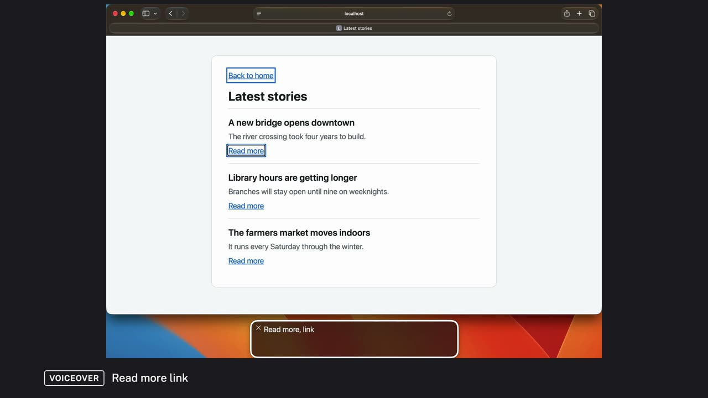
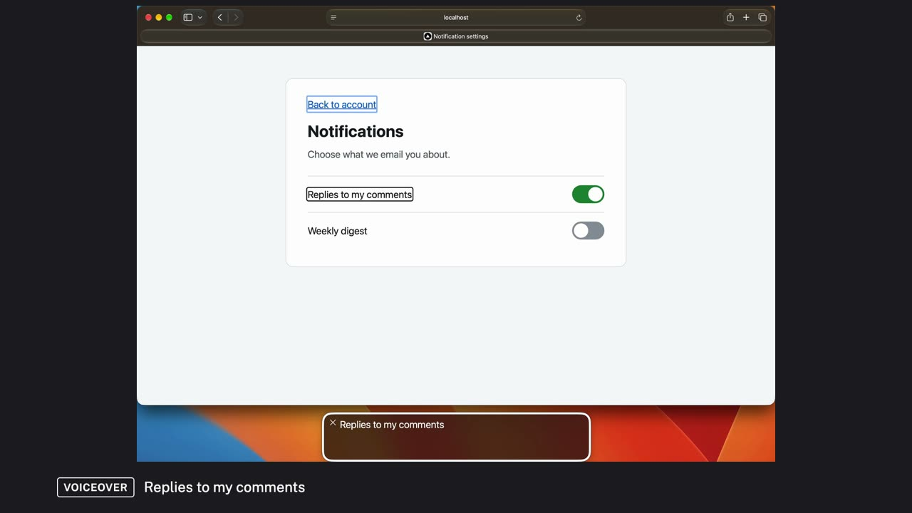

# Three WCAG criteria, heard with VoiceOver

Three common barriers, one per WCAG guideline, each on a small page built to show it. In each video, a tester uses VoiceOver, the screen reader built into the Mac, and a reviewer names the problem, says why it matters and explains the fix. Then the same commands run again on the fixed page.

Each still opens its video. To watch them in the page, with captions you can turn on and off, download this folder and open [index.html](index.html) in a browser.

## The brief

The pages were built for this series, one barrier each, so each test shows one criterion and nothing else. All three barriers were heard with VoiceOver in Safari, and all three are fixed in the example code. After each fix, the same commands were run again, and VoiceOver said what a viewer can see.

None of the three would show up for someone using a mouse. The chart, the links and the switches all look fine. They only fail for someone listening.

- **Fixed: The sales chart read as a file name.** The quarterly report's only content is a bar chart, an image with no text alternative. Reading the page, VoiceOver said “q3-sales.svg image”. Someone listening learns that there's a picture, but not what it shows: sales rising from July to September. Fixed: the image has alt text that names the kind of chart and its numbers. VoiceOver now says “Bar chart of sales in the third quarter, in thousands of dollars: July 120, August 150, September 180.” WCAG 1.1.1 Non-text Content · [Watch it](#non-text)
- **Fixed: Every story link said “Read more”.** Each of three stories ends in a link that says only “Read more”. Nothing in the code ties a link to its story: the titles are styled text, not headings, and each link sits on its own. Jumping from link to link, as screen-reader users often do, VoiceOver said “Read more, link” three times. There's no way to tell which story each one opens. Fixed: each link still shows “Read more”, and hidden text adds its story's title for screen readers. VoiceOver now says, for example, “Read more about a new bridge opens downtown, link”. WCAG 2.4.4 Link Purpose (In Context) · [Watch it](#link-purpose)
- **Fixed: The notification switches were invisible to VoiceOver.** The settings page has two on/off switches that work with a mouse and the keyboard, but they're plain boxes in the code, with no name, no role and no state. Reading the page, VoiceOver said both labels and then “end of main”. It never reached either switch, so to someone listening, the page has nothing to set. Fixed: each switch is a button with the switch role and an on/off state, named by its label. VoiceOver now says “Replies to my comments, on, switch”, and turning one on says “on, Weekly digest, switch”. WCAG 4.1.2 Name, Role, Value · [Watch it](#name-role-value)

> **What these videos are.** VoiceOver in Safari, on macOS 27, driven by a script so each test can be run again the same way. What you hear from VoiceOver is what it said. Each video is narrated by two synthetic voices that introduce themselves at the start: the tester, who uses VoiceOver and says what she hears, and the reviewer, who names the WCAG criterion, says why it matters and explains the fix. The captions label them Tester and Reviewer.
>
> **What they are not.** An audit, or a claim that any page conforms to WCAG. These are example pages built to show one barrier each, tested by one specialist with one screen reader in one browser. Nobody who uses a screen reader every day took part: that comes next, in the recommendations.
>
> **Captions.** Every video has captions for all three voices on screen: the tester, the reviewer and VoiceOver. They are also in each video as a captions track, and as a file you can download, with a transcript under each video.

## How it was tested

1. **A linear reading pass with the screen reader.** Goal: the experience of discovering and understanding the page. It found the chart read as a file name, and the switches VoiceOver never reached. [Video](#non-text)
2. **Structural navigation: jumping from link to link.** Goal: finding information without reading the whole page. It found three links that all said Read more. [Video](#link-purpose)
3. **Controls: name, role and state.** Goal: controls are understandable and usable, not merely discoverable. After the fix, each switch said its name, its role and its state, and changing one was announced. [Video](#name-role-value)

## The videos

### 1.1.1 Non-text Content: a chart with no text alternative

[Watch the video](wcag-1-1-1.mp4) (2:04, captions on screen and as a track) · [captions file](wcag-1-1-1.vtt) · [transcript as text](wcag-1-1-1.transcript.txt)

The tester and the reviewer introduce themselves. The tester reads the quarterly report with VoiceOver, from the heading down, and the reviewer names the problem and why it matters. Then they run the same reading pass on the fixed page.

**Finding.** Before: “q3-sales.svg image”. After: the chart's type and its three numbers.

Transcript

- 0:00 **Tester:** Hi, I'm the tester. I'll use VoiceOver, the screen reader built into the Mac, and tell you what I hear.
- 0:07 **Reviewer:** And I'm the reviewer. When something sounds wrong, I'll name the WCAG criterion it falls under, say why it matters, and explain what changed in the code to fix it.
- 0:18 **Reviewer:** This video is about WCAG 1.1.1, Non-text Content. Anything shown as a picture, like a chart, needs a text alternative that gives a listener what the picture gives a viewer.
- 0:31 **Tester:** Here's a quarterly report, in Safari, with VoiceOver on. Under the heading there's a bar chart of sales for July, August and September. I'll read the page one item at a time, from the link at the top.
- 0:47 **VoiceOver:** heading level 1 Quarterly report
- 0:50 **VoiceOver:** How sales went from July to September.
- 0:53 **VoiceOver:** q3-sales.svg image
- 0:55 **VoiceOver:** end of main
- 0:57 **Tester:** After the sentence under the heading, VoiceOver said q three sales dot S V G, image. That's the file name. It never said what the chart shows.
- 1:07 **Reviewer:** That's a problem under WCAG 1.1.1. The chart has no text alternative, so VoiceOver falls back to its file name. If you're listening, you know there's a picture, but not that sales went up every month.
- 1:23 **Reviewer:** In the code, the image now has alt text. It says it's a bar chart, what it measures, and the three numbers. The chart looks exactly the same.
- 1:32 **Tester:** The same reading pass, on the fixed page.
- 1:38 **VoiceOver:** heading level 1 Quarterly report
- 1:41 **VoiceOver:** How sales went from July to September.
- 1:44 **VoiceOver:** Bar chart of sales in the third quarter, in thousands of dollars: July 120, August 150, September 180. image
- 1:49 **VoiceOver:** end of main
- 1:51 **Tester:** Now VoiceOver reads the chart: what kind of chart it is, and the sales for each month.
- 1:57 **Reviewer:** A listener gets what the chart shows. 1.1.1 holds here.

### 2.4.4 Link Purpose: three links that say Read more

[Watch the video](wcag-2-4-4.mp4) (1:58, captions on screen and as a track) · [captions file](wcag-2-4-4.vtt) · [transcript as text](wcag-2-4-4.transcript.txt)

The tester and the reviewer introduce themselves. The tester jumps from link to link with VoiceOver (VO-Command-L) through the latest stories, and the reviewer names the problem and why it matters. Then they make the same three jumps on the fixed page.

**Finding.** Before: “Read more, link” three times. After: each link names its story.

Transcript

- 0:00 **Tester:** Hi, I'm the tester. I'll use VoiceOver, the screen reader built into the Mac, and tell you what I hear.
- 0:07 **Reviewer:** And I'm the reviewer. When something sounds wrong, I'll name the WCAG criterion it falls under, say why it matters, and explain what changed in the code to fix it.
- 0:18 **Reviewer:** This video is about WCAG 2.4.4, Link Purpose. A link should say where it goes, from its own words, or from the text the code ties to it.
- 0:28 **Tester:** Here's a page of the latest stories, in Safari, with VoiceOver on. There are three stories, and each one ends in a link that says Read more. Screen reader users often jump from link to link to see where they can go, so that's what I'll do.
- 0:47 **VoiceOver:** Read more link
- 0:49 **VoiceOver:** Read more link
- 0:54 **VoiceOver:** Read more link
- 0:56 **Tester:** Three links, and VoiceOver said the same thing each time: Read more, link. Nothing tells me which story each one opens.
- 1:04 **Reviewer:** That's a problem under WCAG 2.4.4. The story titles are styled text, and each link sits on its own, so nothing in the code ties a link to its story. If you're listening, you'd have to open each one to find out where it goes.
- 1:21 **Reviewer:** In the code, each link still shows Read more, and hidden text adds the story's title for screen readers. It looks exactly the same.
- 1:30 **Tester:** The same three jumps, on the fixed page.
- 1:36 **VoiceOver:** Read more about a new bridge opens downtown link
- 1:39 **VoiceOver:** Read more about library hours are getting longer link
- 1:42 **VoiceOver:** Read more about the farmers market moves indoors link
- 1:45 **Tester:** Now each link names its story: a new bridge, library hours, and the farmers market.
- 1:52 **Reviewer:** Each link says where it goes. 2.4.4 holds here.

### 4.1.2 Name, Role, Value: switches built from boxes

[Watch the video](wcag-4-1-2.mp4) (2:21, captions on screen and as a track) · [captions file](wcag-4-1-2.vtt) · [transcript as text](wcag-4-1-2.transcript.txt)

The tester and the reviewer introduce themselves. The tester reads the notification settings page with VoiceOver, and the reviewer names the problem and why it matters. Then they run the same reading pass on the fixed page, and the tester turns on Weekly digest.

**Finding.** Before: VoiceOver never reaches either switch. After: “Replies to my comments, on, switch”; turning on Weekly digest is announced.

Transcript

- 0:00 **Tester:** Hi, I'm the tester. I'll use VoiceOver, the screen reader built into the Mac, and tell you what I hear.
- 0:07 **Reviewer:** And I'm the reviewer. When something sounds wrong, I'll name the WCAG criterion it falls under, say why it matters, and explain what changed in the code to fix it.
- 0:18 **Reviewer:** This video is about WCAG 4.1.2, Name, Role, Value. Every control on a page has to tell a screen reader three things: what it's called, what kind of control it is, and its current state.
- 0:31 **Tester:** Here's a notification settings page, in Safari, with VoiceOver on. On screen there are two switches. Replies to my comments is on, and Weekly digest is off. I'll read the page one item at a time, from the link at the top.
- 0:49 **VoiceOver:** heading level 1 Notifications
- 0:51 **VoiceOver:** Choose what we email you about.
- 0:54 **VoiceOver:** Replies to my comments
- 0:56 **VoiceOver:** Weekly digest
- 0:58 **VoiceOver:** end of main
- 1:00 **VoiceOver:** main
- 1:05 **Tester:** I heard the heading, the sentence under it, and both labels. Then the end of the main content. VoiceOver never reached either switch.
- 1:13 **Reviewer:** That's a problem under WCAG 4.1.2. The switches work with a mouse, but the code gives them no name, no role and no state, so VoiceOver isn't told they're there. If you're listening, it sounds like this page has nothing to set.
- 1:30 **Reviewer:** In the code, each switch is now a button, with the role switch, an on or off state, and the label beside it as its name. It looks exactly the same.
- 1:40 **Tester:** The same reading pass, on the fixed page.
- 1:46 **VoiceOver:** heading level 1 Notifications
- 1:49 **VoiceOver:** Choose what we email you about.
- 1:51 **VoiceOver:** Replies to my comments
- 1:54 **VoiceOver:** Replies to my comments on switch
- 1:56 **VoiceOver:** Weekly digest
- 1:58 **VoiceOver:** Weekly digest off switch
- 2:01 **Tester:** Now each switch says its name, that it's a switch, and whether it's on or off. I'll turn on Weekly digest.
- 2:08 **VoiceOver:** on Weekly digest switch
- 2:10 **Tester:** VoiceOver tells me it's on.
- 2:13 **Reviewer:** Name, role and value are all announced. 4.1.2 holds here.

## Recommendations: test with people with disabilities

This was a first pass. It shows whether things work as built, not whether they help the people they are for. These need people with disabilities, using their own devices and settings:

- **Chart descriptions.** Alt text can carry three numbers. Whether it's enough for a real chart, or whether people would rather have a data table, or a summary of the trend first, is something only the people who rely on it can say. A screen reader shows the alt text is read, not that it's useful. Who: blind people and people with low vision who use a screen reader or magnification, including some who read charts at work
- **Link wording.** Hidden text fixes the links for a screen reader, but people who use voice control say what they see (“click Read more”), and three links with the same visible name are hard to tell apart by voice. Whether to show the title in the link itself is a choice to make with the people it affects. Who: screen-reader users, and people who use voice control, such as Voice Control on the Mac
- **Switches.** Whether “on” and “off” are clear, whether people expect a switch or a checkbox, and whether the label read twice in a reading pass gets in the way. The fix works as built; how it feels to use is a question for the people using it. Who: screen-reader users on the Mac, iPhone and Windows, and keyboard-only users

---

Example pages in examples/wcag. Tested October 17, 2026, with VoiceOver in Safari on macOS 27.
